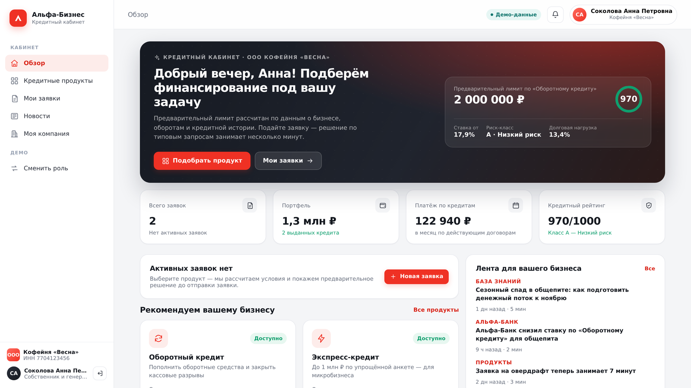

# Умный кредитный кабинет предпринимателя

Прототип цифрового кредитного конвейера для малого и микробизнеса: клиентский веб-кабинет
предпринимателя и рабочее место андеррайтера, связанные одним процессом — от потребности
в финансировании до зачисления денег на счёт.

Кейс: Альфа-Хак × Альфа-Банк, 2026. Все данные синтетические, интеграции с БКИ/ЕГРЮЛ/ФНС
смоделированы локальными моками.



---

## Что умеет решение

**Клиентский кабинет**

- Обзор с предварительным лимитом, риск-классом, портфелем и персональными рекомендациями.
- Подбор продукта по задаче бизнеса, онлайн-калькулятор платежа, предварительная проверка требований.
- Заявка: цель, сумма, срок → отправка → прозрачный таймлайн обработки (автообновление).
- Предложение банка или контрпредложение со сравнением «запрошено / предложено».
- Принятие оферты, пакет документов, подписание (УКЭП смоделирована), выдача и счёт зачисления.
- Запрос уточнений от банка и ответ на него внутри кабинета, загрузка документов.
- Причины отказа и следующий шаг, история всех событий заявки.
- Персональная новостная лента с объяснением релевантности (отрасль, стадия, клиент банка).
- Профиль компании: реквизиты, финансы и динамика, кредитная история (БКИ), проверки ЕГРЮЛ/ФНС.

**Бэк-офис банка**

- Очередь заявок с SLA, скорингом и поиском; вкладки «Очередь / В работе / Решения / Все».
- Карточка заявки: профиль клиента, финансы, БКИ, ЕГРЮЛ/ФНС, документы, скоринг, история.
- Четыре решения: одобрить, контрпредложение, запросить уточнения, отказать.
- Аналитика конвейера: воронка статусов, доля автоматизации, SLA, портфель, модель решения.

---

> Нужна пошаговая инструкция «для чайников» с разбором ошибок —
> см. **[КАК_ЗАПУСТИТЬ.md](КАК_ЗАПУСТИТЬ.md)**. Ниже — краткая версия.

## Быстрый старт

### Вариант A. Docker Compose (рекомендуется)

```bash
cp .env.example .env
docker compose up --build
```

- Приложение: **http://localhost:8080**
- API и Swagger UI: **http://localhost:8000/docs**
- Healthcheck: `curl http://localhost:8000/api/health`

Данные сохраняются в `./data` (SQLite). При первом запуске создаются продукты, компании,
пользователи и новости; повторный запуск данные не дублирует.

### Вариант A2. Один процесс (без Docker и Node.js)

```bash
./start.sh      # Linux/macOS
start.bat       # Windows
# → http://localhost:8000
```

Скрипт сам создаёт venv, ставит зависимости и раздаёт собранный фронтенд из `frontend/dist`.

### Вариант B. Локальный запуск без Docker

Требования: Python 3.11+ (проверено на 3.13), Node.js 20+.

```bash
# backend
cd backend
python -m venv .venv && source .venv/bin/activate
pip install -r requirements.txt
uvicorn app.main:app --reload --port 8000

# frontend (в отдельном терминале)
cd frontend
npm install
npm run dev          # http://localhost:5173, /api проксируется на :8000
```

Сборка фронтенда и раздача из FastAPI одним процессом:

```bash
cd frontend && npm run build
cd ../backend && STATIC_DIR=../frontend/dist uvicorn app.main:app --port 8000
# всё приложение на http://localhost:8000
```

### Вариант C. Тесты и демо-данные

```bash
cd backend
pip install -r requirements.txt pytest httpx
pytest -q                  # 13 passed
```

Наполнить работающий прототип демонстрационным состоянием (три заявки: авто-выдача,
контрпредложение андеррайтера и заявка в очереди):

```bash
python3 tools/seed_demo.py --base http://localhost:8000/api
```

Полезные команды собраны в `Makefile`: `make up`, `make test`, `make seed`, `make dev-backend`.

---

## Тестовые учётные записи

Пароль для всех: `demo1234`.

| Роль | Email | Сценарий |
|---|---|---|
| Клиент | `ivan@vesna.ru` | Кофейня «Весна» — сильный профиль, автоматическое одобрение |
| Клиент | `petr@stroymaster.ru` | ИП «СтройМастер» — заявка уходит андеррайтеру, контрпредложение |
| Клиент | `anna@tehnopark.ru` | ООО «ТехноПарк» — высокая нагрузка, уточнения и отказ |
| Банк | `underwriter@alfabank.ru` | Андеррайтер МСБ — очередь, решения, аналитика |
| Банк | `manager@alfabank.ru` | Клиентский менеджер |

В интерфейсе есть кнопка **«Сменить роль»** (раздел «Демо» в сайдбаре) — быстрое переключение
между клиентом и андеррайтером для демонстрации сквозного сценария.

---

## Пошаговый сценарий проверки (5 минут)

1. Войти как `ivan@vesna.ru` → «Кредитные продукты» → «Оборотный кредит».
2. Установить 700 000 ₽ на 12 месяцев, выбрать цель → «Подать заявку» → отметить согласие →
   «Отправить заявку».
3. Наблюдать автоматическую обработку: проверка → обогащение данными БКИ/ЕГРЮЛ/ФНС → скоринг →
   предложение. Статусы обновляются без перезагрузки страницы.
4. «Принять предложение» → «Подписать документы» → статус «Кредит выдан», счёт и платёж в параметрах.
5. Сменить роль на `petr@stroymaster.ru`, оформить «Оборотный кредит» на 1 800 000 ₽ →
   заявка уходит в ручное рассмотрение.
6. Сменить роль на `underwriter@alfabank.ru` → открыть заявку в очереди → выбрать
   «Контрпредложение», изменить сумму/ставку → сохранить.
7. Вернуться клиентом: в карточке заявки — контрпредложение с бейджем «Условия скорректированы».
8. Открыть «Новости»: лента объясняет, почему материалы релевантны, и меняется вместе со стадией.

Полная матрица сценариев — [`docs/07-test-scenarios.md`](docs/07-test-scenarios.md).

---

## Архитектура

```
backend/   FastAPI + SQLAlchemy + JWT + SQLite (PostgreSQL-ready)
  app/
    routers/        auth, products, applications, bank, news, analytics, company
    services/       pipeline (конвейер), scoring (модель), registry (моки),
                    workflow (статусы/SLA), news (персонализация)
    models.py       ORM-модель данных
    schemas.py      контракты API (Pydantic)
    seed.py         синтетические данные
  tests/            13 автотестов сквозного процесса
frontend/  React 18 + Vite + React Router, собственные стили (дизайн-система в styles.css)
docs/      процесс, архитектура, скоринг, API, данные, тест-сценарии, OpenAPI, Postman
```

Конвейер обработки: `submitted → validation → (data enrichment) → scoring → routing →
offer_issued | manual_review | declined → signing → funded`.

Подробно: [архитектура](docs/02-architecture.md) · [модель процесса](docs/03-credit-process.md) ·
[скоринг](docs/04-scoring-model.md) · [API](docs/05-api.md) · [модель данных](docs/06-data-model.md).

---

## Конфигурация

Все параметры — через переменные окружения (см. `.env.example`).

| Переменная | По умолчанию | Назначение |
|---|---|---|
| `DATABASE_URL` | `sqlite:///./data/credit_cabinet.db` | Строка подключения к БД |
| `JWT_SECRET` | dev-значение | Секрет подписи токенов (заменить в проде) |
| `ACCESS_TOKEN_TTL_HOURS` | `12` | Время жизни токена |
| `DEMO_DELAY_SCALE` | `1.0` | Масштаб паузы между шагами конвейера (0 — без задержек) |
| `OFFER_TTL_HOURS` | `168` | Срок действия предложения |
| `SEED_ON_START` | `true` | Заполнять демо-данными при старте |
| `CORS_ORIGINS` | `*` | Разрешённые origin |
| `STATIC_DIR` | — | Каталог собранного фронтенда для раздачи из FastAPI |

---

## API

- Swagger UI: `http://localhost:8000/docs`, ReDoc: `/redoc`
- Спецификация: [`docs/openapi.json`](docs/openapi.json)
- Коллекция запросов: [`docs/postman_collection.json`](docs/postman_collection.json)

22 эндпоинта: аутентификация, каталог и проверка требований, заявки и оферта, документы,
бэк-офис и очередь, метрики конвейера, новости, профиль компании.

---

## Ограничения и допущения

- Внешние интеграции (БКИ, ЕГРЮЛ/ЕГРИП, ФНС) — локальные моки с синтетическими данными;
  реальных сетевых вызовов нет.
- Кредитное решение — упрощённая объяснимая балльная модель + правила политики, не реальная
  скоринговая система банка.
- Подписание документов, открытие счёта и зачисление смоделированы.
- Вместо LLM используется детерминированная персонализация ленты и правил — предсказуемо
  и воспроизводимо; при развитии возможен ассистент на моделях с открытыми весами.
- SQLite выбран для воспроизводимости на обычном ПК; переход на PostgreSQL описан в документации.

---

## Сторонние компоненты

Список библиотек и смоделированных интеграций — [`THIRD_PARTY_NOTICES.md`](THIRD_PARTY_NOTICES.md).
Все используемые компоненты — open-source, без платных API и закрытых лицензий.

---

## Структура документации

| Документ | Содержание |
|---|---|
| [01-product-concept.md](docs/01-product-concept.md) | Исследование, JTBD, user stories, границы MVP, приоритизация, метрики |
| [02-architecture.md](docs/02-architecture.md) | Компоненты, поток обработки, безопасность, enterprise-требования, эволюция |
| [03-credit-process.md](docs/03-credit-process.md) | Границы процесса, роли, этапы, диаграмма и матрица состояний, SLA |
| [04-scoring-model.md](docs/04-scoring-model.md) | Факторы, веса, риск-классы, стоп-факторы, affordability, ограничения |
| [05-api.md](docs/05-api.md) | Описание API, примеры запросов, коды ответов |
| [06-data-model.md](docs/06-data-model.md) | ER-диаграмма, решения по модели данных, миграция на PostgreSQL |
| [07-test-scenarios.md](docs/07-test-scenarios.md) | Сквозные сценарии и список автотестов |
| [presentation](docs/alfa-credit-cabinet-pitch.pptx) | Презентация решения для защиты |
| [RELEASE.md](RELEASE.md) | Зафиксированная версия, состав поставки, commit hash |
