# 03 · Модель кредитного процесса

## 1. Границы процесса

**Внутри:** от возникновения потребности в финансировании до зачисления средств на счёт —
подбор продукта, заявка, проверки, оценка риска, кредитное решение, предложение, подписание, выдача.

**Снаружи:** налоговый учёт клиента, бухгалтерия банка, реальные денежные переводы, юридически
значимый ЭДО/УКЭП, коллекшн и сопровождение кредита (за рамками MVP).

## 2. Участники и роли

| Роль | Действия в процессе |
|---|---|
| Клиент (предприниматель) | Подаёт заявку, принимает/отклоняет предложение, подписывает документы, отвечает на уточнения, загружает документы |
| Кредитный конвейер (система) | Проверяет полноту, обогащает данными, считает скоринг, маршрутизирует заявку, формирует предложение/отказ, фиксирует события |
| Андеррайтер | Рассматривает пограничные заявки: одобряет, меняет условия, запрашивает уточнения, отказывает |
| Моки внешних источников | БКИ (кредитная история), ЕГРЮЛ/ЕГРИП (статус бизнеса), ФНС «Прозрачный бизнес» (налоговая дисциплина) |

## 3. Этапы процесса

| № | Этап | Вход | Действие | Выход |
|---|---|---|---|---|
| 1 | Потребность | Задача бизнеса | Выбор продукта, расчёт параметров | Черновик заявки, предварительный платёж |
| 2 | Подача | Параметры + согласие | Валидация формы, создание заявки | Статус `submitted` |
| 3 | Проверка | Анкета | Полнота, корректность, лимиты продукта | `validation` → `scoring` |
| 4 | Обогащение | ИНН/ОГРН | Запрос БКИ, ЕГРЮЛ, ФНС (моки) | Снимок данных клиента |
| 5 | Скоринг | Данные клиента и заявки | Балльная оценка, риск-класс, PD | Балл 0–1000, класс A–E |
| 6 | Маршрутизация | Риск-класс + сумма + продукт | Авто-решение / андеррайтинг / отказ | `offer_issued` / `manual_review` / `declined` |
| 7 | Ручное рассмотрение | Карточка заявки | Решение андеррайтера | Одобрение / контрпредложение / уточнения / отказ |
| 8 | Предложение | Условия | Формирование оферты со сроком действия | `offer_issued`, срок 7 дней |
| 9 | Принятие | Оферта | Акцепт или отклонение клиентом | `signing` / `declined` |
| 10 | Подписание | Пакет документов | Подписание (УКЭП смоделирована) | `signed` |
| 11 | Выдача | Подписанный пакет | Открытие счёта, зачисление | `funded` |

## 4. Диаграмма состояний заявки

```mermaid
stateDiagram-v2
    [*] --> draft: клиент создаёт заявку
    draft --> submitted: отправка (submit)
    submitted --> validation: конвейер принимает заявку
    validation --> scoring: данные полные
    scoring --> declined: стоп-фактор / класс E
    scoring --> manual_review: пограничный риск или крупная сумма
    scoring --> offer_issued: авто-одобрение (класс A; B без ограничений)
    manual_review --> offer_issued: андеррайтер одобрил / контрпредложение
    manual_review --> info_requested: нужны уточнения
    manual_review --> declined: отказ андеррайтера
    info_requested --> client_info_provided: клиент ответил
    client_info_provided --> offer_issued: андеррайтер одобрил
    client_info_provided --> declined: отказ андеррайтера
    offer_issued --> signing: клиент принял оферту
    offer_issued --> declined: клиент отказался
    offer_issued --> expired: истёк срок действия
    signing --> signed: документы подписаны
    signed --> funded: средства зачислены
    declined --> [*]
    expired --> [*]
    funded --> [*]
```

### Матрица переходов

| Из | Событие | В | Кто инициирует |
|---|---|---|---|
| draft | submit | submitted | Клиент |
| submitted → validation → scoring | автоматически | — | Конвейер |
| scoring | стоп-фактор | declined | Конвейер |
| scoring | требует ручного решения | manual_review | Конвейер |
| scoring | авто-одобрение | offer_issued | Конвейер |
| manual_review / client_info_provided | approve / counter_offer | offer_issued | Андеррайтер |
| manual_review / client_info_provided | request_info | info_requested | Андеррайтер |
| manual_review / client_info_provided / info_requested | decline | declined | Андеррайтер |
| info_requested | клиент ответил | client_info_provided | Клиент |
| offer_issued | accept | signing | Клиент |
| offer_issued | reject | declined | Клиент |
| offer_issued | TTL истёк | expired | Система |
| signing | подпись | signed → funded | Клиент → Система |

**Недопустимые переходы** возвращают `409 Conflict`: например, акцепт оферты в статусе
`manual_review`, подписание до акцепта, повторная отправка черновика после подачи.

## 5. Правила маршрутизации (routing policy)

| Условие | Маршрут |
|---|---|
| Есть стоп-фактор (просрочка > 60 дней, текущая просрочка, массовый адрес, налоговый долг, статус ≠ «Действующий», срок бизнеса < минимума продукта) | `declined` автоматически |
| Риск-класс A | Авто-одобрение |
| Риск-класс B и сумма < 1,5 млн ₽ | Авто-одобрение |
| Риск-класс B и сумма ≥ 1,5 млн ₽ | Ручное рассмотрение |
| Риск-класс C | Ручное рассмотрение + рекомендация контрпредложения |
| Риск-класс D при нагрузке ≤ 65% | Ручное рассмотрение + контрпредложение |
| Риск-класс D при нагрузке > 65% | Автоматический отказ |
| Риск-класс E | Автоматический отказ |

## 6. Результаты процесса

1. **Одобрение** — предложение на запрошенных условиях.
2. **Контрпредложение** — одобрение с изменёнными параметрами (сумма ↓, ставка ↑, срок изменён);
   клиент видит сравнение «запрошено / предложено».
3. **Запрос уточнений** — процесс приостанавливается до ответа клиента (SLA клиента отслеживается).
4. **Отказ** — с перечнем причин и рекомендацией следующего шага.
5. **Истечение оферты** — если клиент не ответил за 7 дней.

## 7. SLA и тайминги

| Этап | Норматив | Реализация |
|---|---|---|
| Автоматическая проверка и скоринг | < 5 минут | Задержки демо масштабируются `DEMO_DELAY_SCALE` |
| Ручное рассмотрение | 4 часа | `sla_info()` считает остаток, UI подсвечивает `warning` (< 60 мин) и `overdue` |
| Ответ клиента на уточнения | 24 часа (рекомендация) | Отображается в журнале событий |
| Срок действия оферты | 168 часов (7 дней) | `OFFER_TTL_HOURS`, авто-переход в `expired` при чтении |

## 8. Данные, участвующие в процессе

| Группа | Состав | Источник |
|---|---|---|
| Клиент и бизнес | Наименование, ИНН/ОГРН, отрасль, регион, дата регистрации, сотрудники | Анкета / ЕГРЮЛ (мок) |
| Финансы | Выручка (мес., 12 мес.), прибыль, существующие платежи, обороты по счёту, динамика 6 мес. | Анкета / обслуживание в банке |
| Заявка | Продукт, сумма, срок, цель, комментарий | Клиент |
| Кредитная история | Скор БКИ, действующие кредиты, долг, просрочки, запросы | БКИ (мок) |
| Регуляторные проверки | Статус, налоговый долг, нарушения, массовый адрес, смена директора | ЕГРЮЛ/ФНС (мок) |
| Решение | Балл, класс, PD, факторы, рекомендация, вердикт | Конвейер / андеррайтер |
| Документы | Устав, отчётность, залог, прочее | Клиент (файлы-заглушки) |
| События | Тип, переход, автор, комментарий, payload | Система |

## 9. Допущения (явно зафиксированы)

- Кредитное решение — упрощённая, но объяснимая логика: балльная модель + правила; не претендует
  на реальную банковскую политику.
- Подписание документов и выдача средств смоделированы (счёт и зачисление — демонстрационные).
- Внешние источники заменены локальными моками с сохранением смысла интеграции (что и зачем
  проверяется), но без реальных сетевых вызовов.
- Все данные синтетические; совпадения с реальными компаниями случайны.
